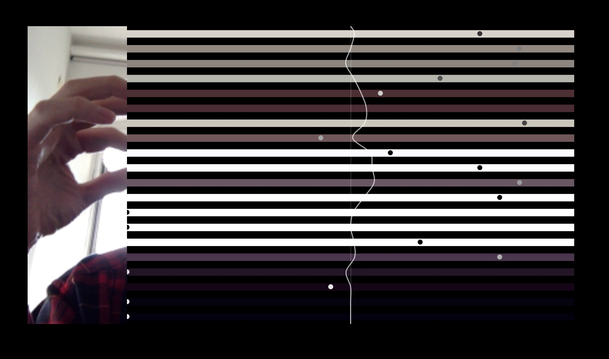

# ScanSeq JS

**Scan Sequence** — an interactive sound art piece that turns your webcam into a musical instrument.

🔗 **Live Demo**: [https://jeonghopark.github.io/scanseqjs/](https://jeonghopark.github.io/scanseqjs/)
🎬 **Video (iOS version)**: [https://vimeo.com/133545595](https://vimeo.com/133545595)
🧪 **Google Experiments**: [https://experiments.withgoogle.com/chrome/scan-sequencer](https://experiments.withgoogle.com/chrome/scan-sequencer)

---



---

## How It Works

20 horizontal scan lines are drawn across the canvas. Each line monitors a corresponding row of pixels from your webcam feed in real time.

1. **Motion detection** — When the brightness of a pixel region changes significantly (threshold: 40), that line is triggered.
2. **Visual response** — A dot travels from the camera preview toward the right side of the canvas along the triggered line.
3. **Sound generation** — When the dot reaches the midpoint of the canvas, a musical note is played. Each line corresponds to a distinct pitch (C3 to D6).
4. **Wave effect** — A fluid wave curve at the center reacts to each note event.

The result is a generative composition driven entirely by movement in front of the camera.

---

## Tech Stack

| Library | Role |
|---|---|
| [p5.js](https://p5js.org/) | Canvas rendering, webcam capture |
| [Tone.js](https://tonejs.github.io/) | Web audio synthesis |

**Audio chain**: `PolySynth` → `Volume (-28dB)` → `FeedbackDelay (16n, 0.4)` → `JCReverb (0.2)`

**Note scale** (bottom to top):
```
C3  E3  D3  G#4  F#4  C4  A#4  D4  F#4  E4
A#4  G#4  D5  C5  F#5  E5  A#5  G#5  C6  D6
```

---

## How to Use

### Run Online
Open the live demo in your browser — no installation needed.
Allow webcam access when prompted.

### Run Locally
```bash
git clone https://github.com/jeonghopark/scanseqjs.git
cd scanseqjs
```

Serve the files with a local HTTP server (required for webcam access):

```bash
# Python 3
python -m http.server 8000

# or Node.js
npx serve .
```

Then open `http://localhost:8000` in your browser and allow camera access.

> **Note**: Webcam access requires a secure context (`https://` or `localhost`). Opening `index.html` directly as a file will not work.

---

## Privacy

**Your camera feed never leaves your device.**
All pixel analysis and audio synthesis happen entirely in your browser. No video, image, or personal data is captured, stored, or transmitted to any server.

---

## Tips

- Move slowly in front of the camera for subtle, melodic patterns.
- Move quickly or wave your hands for dense, rhythmic bursts.
- Try different lighting conditions — contrast changes affect the trigger sensitivity.

---

## Author

**Jeongho Park** (박정호)
[https://github.com/jeonghopark](https://github.com/jeonghopark)
